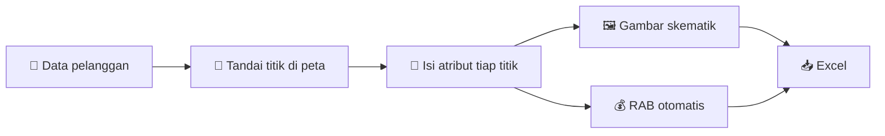

<div align="center">

# ⚡ Sistem Perencanaan Pasang Baru & Tambah Daya

**Survei di HP → gambar jaringan & RAB jadi otomatis → langsung jadi file Excel**

Dibuat untuk divisi Perencanaan **PT PLN (Persero) UP3 Klaten**


</div>

---

## 🤔 Apa ini?

Saat ada calon pelanggan yang mau **pasang baru** atau **tambah daya**, petugas harus survei ke lokasi, menggambar jalur jaringan listrik, lalu menghitung biaya material satu per satu di Excel. Lama dan gampang salah.

**Aplikasi ini mengerjakannya dalam satu alur:**

1. 📍 Petugas **menandai posisi tiang** di peta lewat HP.
2. 📝 Petugas **memilih jenis tiang dan konstruksi** di tiap titik.
3. ✨ Aplikasi **menggambar skema jaringan** dan **menghitung RAB** sendiri.
4. 📥 Hasilnya **diunduh sebagai Excel**.



---

## ✨ Fitur

| | Fitur | Singkatnya |
|---|---|---|
| 👤 | **Data pelanggan** | Catat nama, jenis pekerjaan, lokasi, tarif, dan daya |
| 🗺️ | **Peta & tagging** | Ketuk peta untuk menaruh titik tiang, geser kalau salah, bisa pakai GPS |
| 🛰️ | **Peta / Satelit** | Ganti tampilan peta, zoom sampai dekat ke jalan |
| 📝 | **Atribut titik** | Isi jenis tiang, konstruksi, dan kabel. Panel muncul saat titik diklik |
| 🖼️ | **Gambar skematik** | Bentuk gambar otomatis mengikuti jalur di peta |
| 💰 | **RAB otomatis** | Material, hardware, jasa, SLO, dan PPN dihitung sendiri |
| 📥 | **Ekspor Excel** | Sheet GAMBAR dan sheet RAB langsung jadi |
| 📴 | **Mode offline** | Unduh peta dulu, tetap bisa survei tanpa sinyal |
| 📂 | **Banyak project** | Tiap pelanggan punya project sendiri |

---

## 🔗 Bagaimana atribut titik jadi RAB?

Pilihan di tiap titik **sama persis** dengan nama barang di data harga. Aplikasi tinggal menghitung berapa kali dipakai, lalu mengalikannya dengan harga.

| Yang dipilih di titik | Jadi bagian RAB |
|---|---|
| 🏗️ Jenis tiang | **A.** Penanaman tiang |
| 🔩 Konstruksi baru | **B.** Pemasangan konstruksi (isi materialnya dari data master) |
| 〰️ Kabel + panjangnya | **C.** Penarikan penghantar |
| ⚙️ Peralatan | **D.** Pemasangan peralatan |
| 🧰 Konstruksi bongkar | **E.** Pembongkaran |

> **Contoh:** 3 titik memakai konstruksi `CC1` → RAB mengambil daftar material `CC1` lalu mengalikannya 3. Kalau titik tidak diisi, tidak ikut dihitung.

---

## 🧰 Teknologi yang dipakai

| Untuk apa | Pakai apa |
|---|---|
| 🖥️ Tampilan web | **React + Vite** |
| 🗺️ Peta | **Leaflet**, data peta dari **OpenStreetMap** & citra satelit **Esri** |
| ⚙️ Server | **Node.js + Express** |
| 🗄️ Database | **PostgreSQL** |
| 📊 Excel | **ExcelJS** dan **SheetJS** |
| 🔄 Update langsung | **Socket.IO** |
| 📴 Bisa offline | **PWA + IndexedDB** |
| 🐳 Menjalankan semuanya | **Docker Compose** + **Nginx** |
| 🔎 Melihat isi database | **Adminer** |
| 🌿 Simpan kode | **Git & GitHub**, ditulis di **VS Code** |

---

## 🚀 Cara menjalankan (Windows)

**Siapkan:** [Docker Desktop](https://www.docker.com/products/docker-desktop) dan Git.

**1️⃣ Unduh proyek**
```bash
git clone <alamat-repo-github>
cd <nama-folder>
```

**2️⃣ Nyalakan Docker Desktop**, tunggu sampai tertulis *Engine running*.

**3️⃣ Jalankan aplikasi**
```bash
docker compose up --build
```
Tunggu sampai muncul `API siap di :3000`. Jangan tutup jendelanya.

**4️⃣ Masukkan data harga** (cukup sekali, di terminal baru)
```bash
docker compose run --rm api npm run import -- /data/KKP_PB_53_KVA_PABRIK_ROKOK_HS.xlsx
```

**5️⃣ Buka di browser** 👉 **http://localhost:8080**

| Alamat | Isinya |
|---|---|
| `localhost:8080` | Aplikasi |
| `localhost:8081` | Adminer (server `db`, user `pln`, password `pln`, database `pln`) |

🛑 **Berhenti:** tekan `Ctrl+C`. Data tetap aman.

### 📱 Dipakai di HP
- HP dan laptop harus satu Wi-Fi, lalu buka `http://IP-laptop:8080` (cek IP dengan `ipconfig`).
- GPS dan mode offline di HP butuh **HTTPS**. Untuk dipakai di lapangan, aplikasi perlu dipasang di server.
- Sebelum berangkat, unduh peta area survei lewat menu **Offline & Sinkron**.

---

## 📁 Isi folder

```
📦 proyek
 ┣ 📂 web/      → tampilan aplikasi (React)
 ┣ 📂 server/   → API dan database
 ┣ 📂 shared/   → hitungan RAB, simbol, dan geometri
 ┣ 📂 data/     → file Excel data harga
 ┗ 🐳 docker-compose.yml
```

---

## ⚠️ Masih perlu dikonfirmasi

- 🎨 Warna konstruksi eksisting: sekarang ungu tua, dokumen kebutuhan menyebut hitam.
- 🔌 Upah kabel AAAC dipetakan ke A3C, ini masih dugaan.
- 🏗️ Aturan tiang besi serta simbol schoor dan vang net belum pasti.
- 💲 Sebagian harga KHS kosong karena faktor harganya belum diketahui.
- 🔐 Belum ada login, siapa pun yang tahu kode project bisa membukanya.

---

<div align="center">

Dibuat oleh **Alya** · Teknik Informatika · Institut Teknologi PLN

</div>
